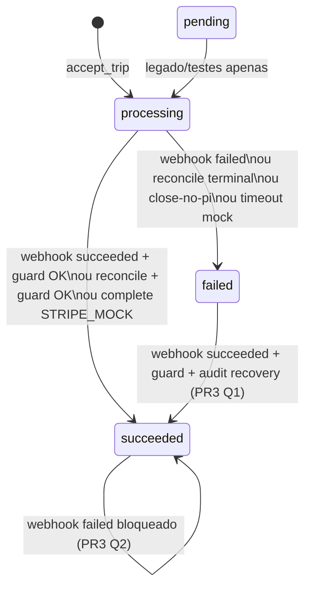

# Fiabilidade dos pagamentos — especificação técnica (Fase 0)

**Data:** 2026-10-22  
**Baseline código:** `main` @ `edc666cc` (pós PR #779)  
**Estado:** especificação **Fase 0** — decisões **Q1–Q8 aprovadas** (Frank, 2026-10-22). **Implementado em `main`:** PR1 (#774) · PR2 (#775) · PR4 (#776) + hotfix (#777) · **PR3 (#779)**. **PR5** não autorizado. Registo operacional (deploy vs smoke PR3): [`TODOdoDIA.md`](../../TODOdoDIA.md) **Fiabilidade pagamentos 22/10**.  
**Itens de backlog:** `R-PAY-ORPHAN-PI` (cancel/recover automático) · activar `ENABLE_PAYMENT_ANOMALY_PERSIST` (decisão ops) · smoke funcional PR3 STAGING.

**Relacionado:** [`diagrams/03_PAYMENTS.md`](../diagrams/03_PAYMENTS.md) · [`PILOT_PAYMENT_RECONCILIATION.md`](PILOT_PAYMENT_RECONCILIATION.md) · [`O_STRIPE_1_RUNBOOK.md`](../ops/O_STRIPE_1_RUNBOOK.md) §11 (L-PAY-02) · [`TODOdoDIA.md`](../../TODOdoDIA.md) (R/O-PAY)

**Fora de scope Fase 0:** activar Stripe LIVE · `STRIPE_MOCK=false` em PROD · cancelamento automático de PaymentIntents órfãos · alterar a máquina de estados `PaymentStatus` em código.

---

## 0. Resumo executivo

A plataforma TVDE trata o **webhook Stripe** como fonte de verdade para transições terminais de `Payment.status` (`succeeded` / `failed`), com **idempotência por `evt_*`**, **fail-closed** em divergência de montante no `payment_intent.succeeded`, e **reembolsos** sincronizados apenas via `charge.refunded`. A reconciliação Admin alinha pares `Trip.completed` + `Payment.processing` com o estado Stripe, com as mesmas guardas de amount/currency.

**Lacunas / follow-ups (pós PR1–PR4):**

1. **Persistência anomalies** — código PR1 + UI PR2 em `main`; **`ENABLE_PAYMENT_ANOMALY_PERSIST=false`** por defeito (sem rows até activação explícita).
2. **PI órfão** — detector read-only PR4; cancel/recover automático continua backlog (`R-PAY-ORPHAN-PI`).
3. **Validação STAGING PR3** — deploy **22/10** + health **200**; **smoke funcional** webhook (ordem/recovery) **não executado** (ver painel `S-PAY-PR3-STG`).

---

## 1. Modelo de estados financeiros

### 1.1 `Payment.status` (BD TVDE)

Definição: `backend/app/models/enums.py` — `PaymentStatus`: `pending` · `processing` · `succeeded` · `failed`.

| Estado | Uso actual no fluxo V1 |
|--------|----------------------|
| `pending` | Reservado; fluxo cartão V1 cria `processing` no **accept** (`trips.accept_trip`). Apenas testes/legado referem `pending`. |
| `processing` | Autorização/captura em curso; estado normal entre accept e webhook/reconcile. |
| `succeeded` | Cobrança capturada e validada (webhook ou reconcile com guard OK). |
| `failed` | Falha terminal (webhook, timeout mock, reconcile, `close-no-pi`). |

**Campos financeiros paralelos (não são `Payment.status`):**

| Campo | Semântica |
|-------|-----------|
| `total_amount` | Montante de referência na BD (accept: estimativa; complete: alinhado a pricing). |
| `refunded_amount` | Acumulado EUR; actualizado por `charge.refunded` (`payment_refund.py`). |
| `derive_refund_status()` | `none` · `partial` · `full` — **derivado** para API; **não** altera `Payment.status`. |

Referência diagrama: [`03_PAYMENTS.md`](../diagrams/03_PAYMENTS.md).

### 1.2 `PaymentIntent.status` (Stripe — manual capture V1)

Estados Stripe relevantes para TVDE (consulta + reconcile em `admin_payment_reconciliation.py`):

| Stripe `status` | Significado operacional V1 |
|-----------------|----------------------------|
| `requires_confirmation` | PI criado no accept (`confirm=false`); amount pode ser actualizado no complete. |
| `requires_action` | SCA pendente no complete → API **409** `payment_requires_action`. |
| `requires_capture` | Autorizado, captura manual pendente. |
| `processing` | Transição Stripe interna. |
| `succeeded` | Captura concluída — webhook `payment_intent.succeeded` (após guard amount/currency). |
| `canceled` | Cancelado (timeout cron, ops, etc.). |
| `requires_payment_method` | Falha método — reconcile trata como terminal falho em pares completed+processing. |

**Metadados comprovados:** em accept real, `metadata={"trip_id": "<uuid>"}` (`trips.py`, `create_authorization_payment_intent`). **Idempotency Stripe:** `tvde-pi-auth-{trip.id}` no accept; chaves adicionais em confirm/capture (`trips.py` / `stripe_service.py`).

**Mock:** `pi_mock_*` quando `STRIPE_MOCK=true` — sem objecto Stripe; reconcile batch **skip** (`stripe_mock`).

### 1.3 Eventos webhook tratados

Implementação: `backend/app/api/routers/webhooks/stripe.py`.

| `event.type` | Lookup | Efeito em `Payment.status` | Efeito refund |
|--------------|--------|----------------------------|---------------|
| `payment_intent.succeeded` | `pi_` do objecto | → `succeeded` se `!= succeeded` **e** guard amount/currency OK; senão mantém `processing` | — |
| `payment_intent.payment_failed` | idem | → `failed` se `!= failed` **e** `!= succeeded` (PR3: bloqueio regressão) | — |
| `charge.payment_failed` | `charge.payment_intent` → `pi_` | idem failed (PR3 se já `succeeded`) | — |
| `charge.refunded` | idem | **Inalterado** (`succeeded` típico) | `refunded_amount = max(atual, Stripe)` |
| Outros com `pi_` válido | idem | Sem mudança de status; marker `evt_*` commit se aplicável | — |
| Sem `pi_` válido | — | Ack 200, skip | — |

**Política V1 refunds:** não aplicar `refund.created` / `refund.updated` no webhook (evitar double count) — ver comentário em `stripe.py` e [`PILOT_STRIPE_REFUND.md`](PILOT_STRIPE_REFUND.md).

### 1.4 Transições BD — válidas, inválidas e regressivas (comportamento **pós-PR3** `#779`)

Legenda: **V** = implementado · **B** = bloqueado por guard ou fluxo.

#### 1.4.1 Máquina `Payment.status` (webhook + reconcile + complete mock)

| Transição | Mecanismo | Classificação |
|-----------|-----------|---------------|
| `processing` → `succeeded` | Webhook / reconcile / mock complete | **V** |
| `processing` → `failed` | Webhook failed / reconcile / close-no-pi | **V** |
| `processing` → `processing` | Mismatch amount no succeeded; duplicate evt já succeeded | **V — fail-closed** |
| `succeeded` → `succeeded` | Duplicate succeeded; failed tardio **ignorado** (PR3) | **V — idempotente / bloqueio** |
| `failed` → `failed` | Duplicate failed | **V — idempotente** |
| `failed` → `succeeded` | Webhook succeeded + guard + `webhook_status_recovery` (flag anomalies opcional) | **V — Q1 B** |
| `succeeded` → `failed` | Webhook failed tardio | **B — Q2 A** (`webhook_status_regression_blocked`) |
| `succeeded` → `processing` | — | **B** |
| Qualquer → via refund webhook | Só `refunded_amount`; status mantém-se | **V** |

**Concorrência (PR3):** lookup `Payment` no webhook com **`SELECT … FOR UPDATE`** antes de mutar estado.

#### 1.4.2 Matriz alvo (**Q1/Q2** — **implementada PR3**)

| De \ Para | `processing` | `succeeded` | `failed` |
|-----------|----------------|-------------|----------|
| `processing` | OK (no-op / mismatch) | OK (guard OK) | OK |
| `succeeded` | **Negar** | OK (idempotente) | **Negar** no webhook (Q2 A); chargeback/disputa **fora** do webhook — ops/refund/reconcile manual (Q2 B) |
| `failed` | **Negar** | OK se Stripe `succeeded` + guard + **audit** (`webhook_status_recovery`, Q1 B) | OK (idempotente) |

**Captura vs pagamento vs reembolso (conceptual):**

| Dimensão | Fonte de verdade | Notas |
|----------|------------------|-------|
| Captura autorizada | Stripe PI + webhook succeeded | BD `succeeded` espelha captura **após** guard |
| Estado viagem | FSM `Trip` | `completed` pode preceder webhook (`processing` temporário) |
| Reembolso | `charge.refunded` | Não regredir `succeeded`; expor `refund_status` derivado |

### 1.5 Duplicados, atraso e ordem

| Cenário | Comportamento actual (verificado) |
|---------|-----------------------------------|
| **Reentrega mesmo `evt_*`** | `INSERT stripe_webhook_events ON CONFLICT DO NOTHING`; se rowcount 0 → rollback + **200** (`stripe_webhook_duplicate_event` implícito no path early) |
| **Novo `evt_*`, mesmo PI, segundo succeeded** | Payment já `succeeded` → log `stripe_webhook_duplicate_event` note=`already_succeeded` |
| **Webhook antes da linha Payment** | PI desconhecido → **200** + `stripe_webhook_payment_not_found_ack`; se `evt_*` presente, **marker persistido** (commit L120–159) — Stripe **não** reentrega esse evento |
| **Webhook atrasado após reconcile manual** | Idempotente se status já terminal; senão regras PR3 |
| **Ordem failed → succeeded** | Permitido se guard OK + audit recovery (Q1 B) |
| **Ordem succeeded → failed** | **Bloqueado** no webhook (Q2 A); log + anomaly `webhook_status_regression_blocked` |
| **Sem `stripe_event_id` no payload** | Não claim L-PAY-01; processamento pode repetir efeitos idempotentes por status |

**Documentação L-PAY-02 (Q7 A):** [`O_STRIPE_1_RUNBOOK.md`](../ops/O_STRIPE_1_RUNBOOK.md) §11 alinhado ao código — `not_found` **persiste** marker quando `evt_*` presente.

### 1.6 Ficheiros de referência (estados)

| Área | Path |
|------|------|
| Webhook | `backend/app/api/routers/webhooks/stripe.py` |
| Accept / complete | `backend/app/services/trips.py` |
| Guards amount | `backend/app/services/payment_amount_guards.py` |
| Reconcile | `backend/app/services/admin_payment_reconciliation.py` |
| Refunds | `backend/app/services/payment_refund.py` |
| Modelo | `backend/app/db/models/payment.py`, `stripe_webhook_event.py` |
| Health | `backend/app/services/system_health.py` |

---

## 2. Observabilidade (`O-PAY-WEBHOOK-ANOMALY`)

### 2.1 Princípios

1. **Preservar L-PAY-02:** HTTP **200** para `stripe_webhook_payment_not_found_ack` e `stripe_webhook_succeeded_amount_mismatch` — **não alterar** sem decisão explícita de produto/ops.
2. **200 ≠ sucesso financeiro:** Admin e ops devem distinguir ACK de entrega vs actualização de `Payment.status`.
3. **Read-only na detecção:** Fase 1 não altera fluxos de cobrança; apenas regista/agrega.

### 2.2 Tipos de anomalia (taxonomia proposta)

| `anomaly_type` | Origem (`log_event` / health) | Descrição |
|----------------|------------------------------|-----------|
| `webhook_payment_not_found` | `stripe_webhook_payment_not_found_ack` | Evento Stripe com `pi_` sem `Payment` local |
| `webhook_succeeded_amount_mismatch` | `stripe_webhook_succeeded_amount_mismatch` | Succeeded Stripe rejeitado por guard; payment fica `processing` |
| `webhook_db_error` | `stripe_webhook_db_error_nack` | Falha SQL → 500 (Stripe retry) |
| `webhook_refund_skipped` | `stripe_webhook_refund_skipped` | Refund ignorado (ex.: currency_mismatch) |
| `capture_blocked_amount_mismatch` | `payment_capture_blocked_amount_mismatch` | Complete não capturou (fail-closed) |
| `health_stuck_processing` | System Health `stuck_payments` | `processing` > 10 min |
| `health_completed_not_succeeded` | `inconsistent_financial_state` issue=`trip_completed_but_payment_not_succeeded` | Divergência trip/payment |
| `health_succeeded_trip_not_completed` | issue=`payment_succeeded_but_trip_not_completed` | Divergência inversa |
| `health_missing_payment` | `missing_payment_records` | Trip ≥ accepted sem Payment |
| `orphan_stripe_pi` | (futuro detector R-PAY) | PI Stripe sem row TVDE — ver §3 |
| `webhook_status_recovery` | Webhook PR3 (Q1 B) | `failed` → `succeeded` legítimo (ex. retry SCA) |
| `webhook_status_regression_blocked` | Webhook PR3 (Q2 A) | Evento failed ignorado com payment já `succeeded` |
| `webhook_status_regression` | — | **Obsoleto** pós-PR3; usar `webhook_status_regression_blocked` |

### 2.3 Registo auditável (proposta Fase 1)

**Opção recomendada:** tabela append-only `payment_anomalies` (migration dedicada).

| Campo | Obrigatório | Notas |
|-------|-------------|-------|
| `id` | UUID PK | |
| `anomaly_type` | sim | Enum/string estável |
| `severity` | sim | `critical` · `warning` · `info` |
| `stripe_event_id` | se existir | Idempotência: **`UNIQUE (anomaly_type, stripe_event_id)`** quando `stripe_event_id` não null |
| `payment_intent_id` | se existir | `pi_*` |
| `payment_id` | opcional | UUID TVDE |
| `trip_id` | opcional | UUID; preferir metadata + BD |
| `event_type` | opcional | Stripe `event.type` |
| `payload_json` | sim | Subconjunto: amounts, currencies, `reason`, `from_status`, `to_status` |
| `environment` | sim | `local` · `staging` · `production` (de `settings`) |
| `stripe_mode` | sim | `mock` · `test` · `live` (derivado `STRIPE_MOCK` + prefixo chave — **sem** persistir segredos) |
| `created_at` | sim | timestamptz UTC |

**Idempotência alternativa (sem evt):** `UNIQUE (anomaly_type, payment_intent_id, date_trunc('minute', created_at))` — evitar duplicar spam; preferir evt quando existir.

**Ingestão:**

- Webhook: insert **mesma transacção** que commit do marker (not-found / mismatch) **ou** transacção separada pós-commit — PR1 deve provar ausência de deadlock e que falha de insert **não** impede ACK 200 (try/except + log).
- Health: **não** duplicar linhas por cada poll; agregar snapshot diário ou só contadores em cache (PR2).

### 2.4 Severidade e criticidade

| Severidade | Critérios | Exemplos |
|------------|-----------|----------|
| **critical** | Dinheiro capturado ou viagem completed com risco de não-pagamento não explicado; DB webhook NACK | `health_completed_not_succeeded` persistente; `webhook_db_error`; mismatch + trip completed > SLA |
| **warning** | Fail-closed intencional; investigação ops | `webhook_succeeded_amount_mismatch`; `capture_blocked_amount_mismatch`; `webhook_payment_not_found` |
| **info** | Idempotência / ruído test | duplicate evt notes; refund idempotent no change |

**Distinção Admin Saúde actual** (`system_health.py`):

- **Crítico (degraded):** stuck payments, trips accepted/ongoing too long, inconsistent_financial_state, missing_payment_records.
- **Informacional:** `drivers_unavailable_too_long`.

**Extensão PR2 (Q4 A — decisão inicial):** secção **`payment_webhook_anomalies`** em `GET /admin/system/health` (ou sub-recurso):

- Contagens **24h / 7d** por `anomaly_type` (desde `payment_anomalies`).
- Últimos **N** registos (N≤20) read-only, sem PII desnecessária.
- **Não** alterar `status` global (`ok` / `degraded`) com base em anomalies isoladas — anomalias **visíveis** mas health continua a degradar só pelos buckets actuais (stuck, inconsistent, etc.). Reavaliar limiares numa fase posterior se necessário.

### 2.5 Retenção (Q3 C — provisória)

| Camada | Decisão V1 | Notas |
|--------|------------|-------|
| BD `payment_anomalies` | **Sem purga automática** na V1 | Retenção definitiva (ex. 90d / 365d / arquivo) **pendente** validação legal/fiscal; PR1 **não** inclui job de purge |
| Logs Render (`log_event`) | Retenção plataforma | Ops |
| `stripe_webhook_events` | Manter indefinido (PK evt) | Idempotência L-PAY-01 |

### 2.6 Integração operacional

- **Admin → Sistema → Saúde:** cards existentes + bloco «Anomalias webhook (24h)».
- **Alertas:** Sentry/log-based thresholds (ex.: >0 `webhook_payment_not_found` / h em staging live) — **sem** obrigatoriedade de pager Fase 1; alinhar [`O_STRIPE_1_RUNBOOK.md`](../ops/O_STRIPE_1_RUNBOOK.md) §11 passo 5.
- **Runbook humano:** manter fluxo Dashboard → BD → reconcile; anomalies table fornece `trip_id` / `pi_` / `evt_`.

### 2.7 Inventário `log_event` pagamentos/webhook (baseline)

| Evento | Ficheiro |
|--------|----------|
| `stripe_webhook_payment_not_found_ack` | `webhooks/stripe.py` |
| `stripe_webhook_succeeded_amount_mismatch` | idem |
| `stripe_webhook_payment_succeeded` | idem |
| `stripe_webhook_payment_failed` | idem |
| `stripe_webhook_duplicate_event` | idem |
| `stripe_webhook_payment_refunded` | idem |
| `stripe_webhook_refund_skipped` | idem |
| `stripe_webhook_db_error_nack` | idem |
| `payment_capture_started` / `payment_capture_success` / `payment_capture_blocked_amount_mismatch` | `trips.py` |
| `admin_reconcile_*` | `admin.py` + reconcile service |
| `timeout_payment_cancel_failed` | `trip_timeouts.py` |
| `trip_accepted` (incl. `payment_intent_id`) | `trips.py` |

---

## 3. PaymentIntents órfãos (`R-PAY-ORPHAN-PI`)

### 3.1 Definições

| Classe | Definição |
|--------|-----------|
| **Órfão Stripe→TVDE** | PI existe na conta Stripe (API retrieve/list) **sem** row `payments.stripe_payment_intent_id = pi_*` |
| **Órfão TVDE→Stripe** | Row Payment com `pi_*` inexistente no Stripe (`resource_missing`) — **já** tratado por reconcile → `failed` |
| **PI aberto** | Stripe `status` ∈ {`requires_confirmation`, `requires_action`, `requires_capture`, `processing`} |
| **PI terminal** | `succeeded`, `canceled`, `requires_payment_method` (falha método) |

**Não aprovado:** cancelamento automático de PI aberto órfão (backlog [`TODOdoDIA.md`](../../TODOdoDIA.md): reconcile observa terminal; não cancela abertos).

### 3.2 Detector read-only (**implementado PR4** — merge #776, hotfix #777)

**Pré-condições (fail-safe):**

- `STRIPE_MOCK=true` → **skip** com reason `stripe_mock` (paridade `reconcile_stripe_for_completed_processing`).
- Chave API do ambiente actual apenas (`settings` — test em staging live; **nunca** misturar LIVE key em job STG).
- Janela temporal: PIs `created` ∈ [now − 7d, now − **grace**] — default **grace = 5 minutos** para evitar falso positivo accept (Stripe antes de commit BD).

**Algoritmo v1:**

1. `PaymentIntent.list(created=gte, lte, limit=100)` paginado (cap **500**/execução).
2. Filtrar `metadata.trip_id` presente e UUID válido **ou** PI id prefix match em audit logs (fallback fraco — só info).
3. Para cada `pi_*`: `SELECT 1 FROM payments WHERE stripe_payment_intent_id = :pi`.
4. Se ausente → emitir finding:
   - `orphan_class`: `open` | `terminal_succeeded` | `terminal_canceled` | `terminal_other`
   - `trip_id_metadata`, `stripe_status`, `amount`, `currency`, `created` (Stripe)
5. **Não** chamar `cancel` / `capture`.

**Falsos positivos mitigados:**

| Risco | Mitigação |
|-------|-----------|
| Race accept | grace 5 min |
| PI teste manual sem metadata | classificar `info`; ignorar se sem `trip_id` metadata |
| Conta/env errado | guard `stripe_mode` + health flag `orphan_scan_skipped_wrong_env` |
| Duplicata list | idempotência finding `(pi_id, scan_run_id)` |

**Exposição (Q5 A):**

- Admin `GET /admin/ops/orphan-payment-intents/preview` (super_admin) — JSON only (**PR4**).
- **Sem cron** Render na V1; execução sob pedido ops.
- **Smoke STAGING (22/10/2026):** consulta manual Admin Saúde · `scan_status=ok` · nenhum órfão confirmado nem inconclusivo **na janela/página analisadas** · pós-#777 HTTP 500 por `StripeObject.metadata` **resolvido**. **Não** implica ausência global de órfãos na conta Stripe; **PROD não** testado. Registo canónico: [`TODOdoDIA.md`](../../TODOdoDIA.md) **`S-PAY-PR4-STG`** — **não** duplicar acta completa em [`O_STRIPE_1_RUNBOOK.md`](../ops/O_STRIPE_1_RUNBOOK.md) §11 (mantém runbook webhook L-PAY-02).

### 3.3 PI com metadata `trip_id` sem Payment — cenário crash

Ordem accept (`trips.py`): **Stripe create → add Payment → commit**. Se **commit falhar** após create Stripe, existe PI com `metadata.trip_id` e **sem** Payment — detector deve listar; **recuperação manual** Dashboard + decisão produto (ligar Payment retroactivamente **não** especificado V1).

---

## 4. Segurança e cenários de teste

### 4.1 Riscos documentados

| Risco | Mecanismo actual | Mitigação existente | Gap |
|-------|------------------|---------------------|-----|
| Eventos fora de ordem | Webhook sobrescreve status se `!= target` | Idempotência parcial | Matriz alvo §1.4.2 + testes |
| Concorrência accept/complete/timeout | Row locks em timeouts; trip FSM | `trip_timeouts._timeout_payment_gate` | Crash pré-commit |
| Crash pós-PI Stripe | Órfão Stripe | — | R-PAY detector |
| Falha commit BD webhook | 500 + retry | `stripe_webhook_db_error_nack` | Monitor NACK |
| Reentrega webhook | `stripe_webhook_events` | L-PAY-01 tests | evt ausente no payload |
| Reconcile repetido | skip `already_succeeded`; dry_run | admin audit | batch limit 500 |
| Divergência amount/currency | guard webhook + reconcile + capture | fail-closed | ops alert |
| Dupla cobrança | 1 Payment/trip; unique `pi_*` | DB constraints | — |
| Duplo reembolso BD | `max(previous, stripe)` | charge.refunded only | — |
| Viagem completed sem succeeded | Estado intermédio | Health + reconcile | SLA alert |

### 4.2 Testes determinísticos propostos (por PR)

| ID | Cenário | Assert principal | Ficheiro teste (novo ou extend) |
|----|---------|------------------|--------------------------------|
| T-O1 | Duplicate `evt_*` | 200; single row marker; single status change | extend `test_stripe_webhook_idempotency_tx.py` |
| T-O2 | not_found + evt | 200; marker; anomaly row (Fase 1) | `test_payment_anomaly_not_found.py` |
| T-O3 | mismatch succeeded | processing; anomaly; 200 | `test_payment_anomaly_mismatch.py` |
| T-O4 | failed → succeeded | Guard OK → `succeeded`; audit `webhook_status_recovery` (Q1 B) | `backend/tests/test_webhook_payment_status_guards_pr3.py` |
| T-O5 | succeeded → failed | Regressão **bloqueada**; `webhook_status_regression_blocked` (Q2 A) | `backend/tests/test_webhook_payment_status_guards_pr3.py` |
| T-O6 | Reconcile idempotent | second call skip | `test_admin_payment_reconciliation.py` |
| T-O7 | accept Stripe ok, commit fail | Órfão simulado (mock rollback) | extend `test_accept_offer_stripe_failure_atomicity.py` |
| T-O8 | Orphan scanner | mock list → preview JSON | `test_orphan_pi_scanner.py` |
| T-O9 | STRIPE_MOCK skip scan | skipped reason | idem |
| T-O10 | Refund out-of-order | refunded_amount monotonic | `test_stripe_webhook_charge_refunded.py` |

**Regressão obrigatória CI:** `test_webhook_payment_status_guards_pr3.py`, suite `test_stripe_webhook_*`, `test_admin_payment_reconciliation.py`, `test_timeout_stripe_cancel_fail_closed.py`.

---

## 5. Plano de implementação (PRs pequenos)

### PR1 — Persistência anomalias webhook (O-PAY core) — **autorizado a implementar isoladamente**

| Item | Detalhe |
|------|---------|
| **Scope** | Migration `payment_anomalies`; insert from webhook paths **not-found** + **amount mismatch** (+ recomendado: `webhook_db_error` no path 500) |
| **Dependências** | **Nenhuma** — não requer PR2, PR3, PR4 nem PR5 |
| **Testes** | T-O2, T-O3; regressão `test_stripe_webhook_idempotency_tx.py` |
| **Aceitação** | ACK 200 inalterado (L-PAY-02); duplicate `evt_*` → uma anomaly; sem segredos em `payload_json` |
| **Risco** | Falha ao inserir anomaly **não** pode impedir ACK 200 — insert best-effort |
| **Rollback** | `alembic downgrade` + `ENABLE_PAYMENT_ANOMALY_PERSIST=false` (default **off** até smoke STG) |

Ver **§9** — plano técnico detalhado PR1.

### PR2 — Admin Saúde + preview anomalies (O-PAY surface)

| Item | Detalhe |
|------|---------|
| **Scope** | Extend `system_health.py` ou endpoint admin read-only agregações 24h |
| **Ficheiros** | `system_health.py`, `admin.py`, schemas, web Admin card (se UI já consome health) |
| **Dependências** | PR1 |
| **Testes** | API contract test health anomalies block |
| **Aceitação** | Super_admin vê contadores; PROD mock não quebra |
| **Risco** | Performance query — index `(created_at, anomaly_type)` |
| **Rollback** | Revert UI + API field optional |

### PR3 — Matriz webhook anti-regressão (**Q1 B + Q2 A+B**) — **DONE**

| Item | Detalhe |
|------|---------|
| **Entrega** | PR [#779](https://github.com/frankbexxx/tvde/pull/779) · merge `edc666cc` · `webhooks/stripe.py` · `payment_anomalies.py` · `test_webhook_payment_status_guards_pr3.py` |
| **Scope** | Q2 A: bloqueio `succeeded→failed`; Q1 B: `failed→succeeded` com guards + `webhook_status_recovery`; `FOR UPDATE`; anomalies via `begin_nested()` |
| **Testes** | **80** locais PASS (17 PR3 + regressões); CI backend-ci + web-e2e **PASS** |
| **STAGING** | Deploy Live **22/10/2026** · health **200** · smoke funcional PR3 **não executado** — [`TODOdoDIA.md`](../../TODOdoDIA.md) `S-PAY-PR3-STG` |
| **Aceitação** | L-PAY-02 ACK inalterado; flag anomalies **off** |
| **Rollback** | Revert PR #779 |

### PR4 — Detector órfãos read-only (R-PAY) — **Q5 A: só preview manual** — **DONE**

| Item | Detalhe |
|------|---------|
| **Scope** | `orphan_payment_intent_scan.py` + **`GET /admin/ops/orphan-payment-intents/preview`** (super_admin); **sem cron** Render na V1 |
| **Entrega** | PR [#776](https://github.com/frankbexxx/tvde/pull/776) · hotfix [#777](https://github.com/frankbexxx/tvde/pull/777) (`StripeObject.metadata` via `.to_dict()`) · `main` @ `820e4a33` |
| **Smoke STAGING** | **22/10/2026 PASS** (consulta efectuada; ver §3.2) |
| **Dependências** | Stripe TEST API quota; skip `STRIPE_MOCK` |
| **Aceitação** | Zero mutações Stripe; grace ≥ 5 min; paginação SDK |
| **Risco** | Rate limit — cap 500/run; cobertura parcial por janela/página |
| **Rollback** | Remove route; sem migration |

### PR5 — Recuperação automática — **opcional, NÃO autorizado (Q6 A)**

| Item | Detalhe |
|------|---------|
| **Scope** | Cron auto `reconcile_stripe_for_completed_processing` — **fora de autorização** |
| **Decisão** | **Q6 A:** manter reconciliação **manual** Admin (`stripe-sync`, single trip) |
| **Nota** | Entrada futura no backlog só com nova aprovação explícita; **nunca** cancel PI órfão |

**Ordem recomendada:** **PR1** (isolado) → PR2 → PR4 → PR3 · **PR5 não planeado**.

---

## 6. Decisões aprovadas (Frank — 2026-10-22)

| # | Decisão | Justificação resumida | PRs |
|---|---------|----------------------|-----|
| **Q1** | **B** — `failed` → `succeeded` **permitido** via webhook se guard OK, com **auditoria** (`webhook_status_recovery` em `payment_anomalies` + `log_event`) | Preserva retry SCA real; visibilidade ops sem bloquear recuperação Stripe | PR3 (+ tipos PR1) |
| **Q2** | **A+B** — **bloquear** `succeeded` → `failed` no webhook; chargeback/disputa **fora** do webhook (refund manual / ops, não regressão de `Payment.status`) | Evita viagem `completed` + payment `failed` por entrega tardia; alinha V1 refunds a `charge.refunded` | PR3 |
| **Q3** | **C provisória** — **sem purga automática** V1; retenção definitiva pendente legal/fiscal | PR1 mais simples; evita apagar evidência antes de compliance | PR1 schema |
| **Q4** | **A inicial** — anomalies **visíveis** (PR2); **não** degradar System Health só por warnings | Evita flapping STG; buckets actuais mantêm-se | PR2 |
| **Q5** | **A** — preview **manual** órfãos; **sem cron** | Controlo ops; zero jobs Render até necessidade provada | PR4 |
| **Q6** | **A** — reconciliação **manual**; PR5 **não autorizado** | Risco financeiro auto-batch; governança super_admin actual suficiente | — |
| **Q7** | **A** — runbook §11 corrigido (marker `evt_*` em not-found) | Alinha ops ao código L-PAY-01 | Doc ✓ |
| **Q8** | **A** — **sem** compensação automática pós-crash accept | Risco duplicar Payment / amounts errados; detector + manual | — |

**Estado implementação (22/10/2026):** PR1 · PR2 · PR3 · PR4 **merged** em `main`; ciclo Fase 0 **código completo**; PR5 excluído; **`ENABLE_PAYMENT_ANOMALY_PERSIST=false`**; Stripe LIVE **não** autorizado.

---

## 9. PR1 — plano técnico detalhado (implementação isolada)

### 9.1 Confirmação de isolamento

| Pergunta | Resposta |
|----------|----------|
| PR1 depende de PR2? | **Não** — health UI/API fica para PR2 |
| PR1 depende de PR3? | **Não** — guards de ordem webhook ficam para PR3 |
| PR1 depende de PR4/PR5? | **Não** |
| PR1 altera L-PAY-02 HTTP? | **Não** — só side-effect persistido quando flag on |
| PR1 exige Stripe LIVE ou STG ops? | **Não** — validável em CI + local |

### 9.2 Ficheiros a criar ou alterar (lista exacta prevista)

| Acção | Path |
|-------|------|
| **Criar** | `backend/app/db/models/payment_anomaly.py` |
| **Criar** | `backend/app/services/payment_anomalies.py` — `record_payment_anomaly(...)`, idempotência `(anomaly_type, stripe_event_id)` |
| **Criar** | `backend/alembic/versions/<revision>_payment_anomalies.py` — `down_revision = "a0b1c2d3e4f6"` (head actual) |
| **Criar** | `backend/tests/test_payment_anomaly_webhook_not_found.py` (T-O2) |
| **Criar** | `backend/tests/test_payment_anomaly_webhook_mismatch.py` (T-O3) |
| **Alterar** | `backend/app/db/models/__init__.py` — export `PaymentAnomaly` |
| **Alterar** | `backend/app/api/routers/webhooks/stripe.py` — chamadas best-effort após paths not-found / mismatch / (opcional) antes de re-raise em DB error |
| **Alterar** | `backend/app/core/config.py` — `ENABLE_PAYMENT_ANOMALY_PERSIST: bool = False` |

**Fora de PR1:** `system_health.py`, `admin.py`, UI web, orphan scanner, alterações PR3 em failed/succeeded guards.

### 9.3 Migration `payment_anomalies` (conteúdo mínimo)

Tabela sugerida `payment_anomalies`:

- `id` UUID PK  
- `anomaly_type` VARCHAR NOT NULL (index)  
- `severity` VARCHAR NOT NULL — `critical` | `warning` | `info`  
- `stripe_event_id` VARCHAR NULL  
- `payment_intent_id` VARCHAR NULL  
- `payment_id` UUID NULL FK `payments.id` ON DELETE SET NULL (opcional)  
- `trip_id` UUID NULL (sem FK obrigatório — not-found pode não ter trip)  
- `event_type` VARCHAR NULL  
- `payload_json` JSONB NOT NULL DEFAULT `{}`  
- `environment` VARCHAR NOT NULL  
- `stripe_mode` VARCHAR NOT NULL — `mock` | `test` | `live` | `unknown`  
- `created_at` TIMESTAMPTZ NOT NULL DEFAULT now()

Índices: `(created_at DESC)`, `(anomaly_type, created_at DESC)`; **UNIQUE** parcial ou constraint `UNIQUE (anomaly_type, stripe_event_id)` WHERE `stripe_event_id IS NOT NULL`.

**Q3 C:** migration **sem** tabela de purge / sem cron delete.

### 9.4 Feature flag

| Variável | Default | Comportamento |
|----------|---------|---------------|
| `ENABLE_PAYMENT_ANOMALY_PERSIST` | `false` | `false`: zero writes; webhook idêntico ao actual excepto código no-op. `true`: insert best-effort. |

Activar em STAGING live só após smoke dedicado (checklist futuro PR1).

### 9.5 Ingestão webhook (PR1)

| Path | `anomaly_type` | `severity` | Momento |
|------|----------------|------------|---------|
| Payment not found | `webhook_payment_not_found` | `warning` | Após log `stripe_webhook_payment_not_found_ack`, antes commit |
| Succeeded mismatch | `webhook_succeeded_amount_mismatch` | `warning` | Após log mismatch, payment stays `processing` |
| DB error (opcional) | `webhook_db_error` | `critical` | Com `stripe_webhook_db_error_nack` |

Tipos `webhook_status_recovery` / `webhook_status_regression_blocked` — **PR3**, não PR1.

### 9.6 Testes PR1

| ID | Ficheiro | Assert |
|----|----------|--------|
| T-O2 | `test_payment_anomaly_webhook_not_found.py` | Flag on → 1 row; flag off → 0; ACK 200; duplicate evt → 1 row |
| T-O3 | `test_payment_anomaly_webhook_mismatch.py` | payment `processing`; anomaly warning; ACK 200 |
| Regressão | `test_stripe_webhook_idempotency_tx.py` | Sem alteração comportamento marker/status |

### 9.7 Critérios de aceitação PR1

1. CI backend verde com flag default off.  
2. Com flag on em testes: anomalies persistidas para not-found e mismatch.  
3. Nenhum secret / PAN / `client_secret` em `payload_json`.  
4. Falha simulada no insert de anomaly → webhook ainda **200** (not-found/mismatch).  
5. PROD com flag off → deploy seguro (migration additive only).

### 9.8 Rollback

1. Desactivar `ENABLE_PAYMENT_ANOMALY_PERSIST`.  
2. Se necessário: `alembic downgrade` uma revisão (tabela drop). Dados anomalies perdidos — aceitável V1 (Q3 C).

---

## 7. Compatibilidade (checklist)

- [x] Stripe TEST STAGING (manual capture, 3DS, refunds) — fluxos intactos na spec.
- [x] Idempotência `evt_*` — preservada.
- [x] L-PAY-02 ACK 200 — preservada.
- [x] PROD `STRIPE_MOCK=true` — skip Stripe API em reconcile/scan.
- [x] Sem Stripe LIVE nesta fase.
- [x] Histórico pagamentos + matching viagens — sem alteração Fase 0.

---

## 8. Referências de testes existentes (baseline CI)

| Ficheiro | Cobertura |
|----------|-----------|
| `backend/tests/test_stripe_webhook_idempotency_tx.py` | L-PAY-01 atomicidade marker + status |
| `backend/tests/test_stripe_webhook_charge_refunded.py` | Refunds |
| `backend/tests/test_stripe_webhook_payment_failed_ongoing.py` | Fail + trip ongoing |
| `backend/tests/test_accept_offer_stripe_failure_atomicity.py` | Stripe fail → no accept persist |
| `backend/tests/test_admin_payment_reconciliation.py` | stripe-sync, mismatch block |
| `backend/tests/test_timeout_stripe_cancel_fail_closed.py` | Timeout cancel |
| `backend/tests/test_stripe_auth_pi_confirm_capture_chain.py` | Cadeia auth/capture |

---

*Fase 0 spec — 2026-10-22. Decisões Q1–Q8 incorporadas. PR1 autorizado isoladamente; aguardar commit/revisão Frank antes de implementação.*
